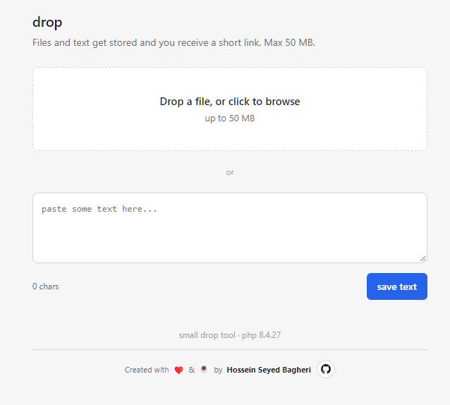

# file-to-link-PHP

**A tiny, self-hosted file uploader that turns files and text into shareable links.**

Drop a file, paste some text, and get a short, random URL you can share instantly. No accounts, no frameworks, no Composer, and no build step — just one PHP file and a MySQL database.

Built for shared hosting, where you need a quick way to upload something and get a link without deploying an entire application.



## ✨ Features

- **Drag & drop uploads** — drop a file onto the upload area or select one manually.
- **Text snippets** — paste text and save it as `snippet.txt`.
- **Short, random links** — unique 8-character codes using an unambiguous alphabet, avoiding confusing characters such as `0`, `O`, `l`, and `I`.
- **Live upload progress** — accurate upload progress powered by `XMLHttpRequest.upload.onprogress`.
- **Instant previews** — display images in the browser and text in a readable `<pre>` block.
- **Direct downloads** — download files with their original filenames.
- **Custom 404 page** — unknown routes and invalid codes share the same polished error page.
- **Zero dependencies** — no Composer, npm, external scripts, or external fonts. Even the favicon is an inline SVG.

## 🛠️ Requirements

- PHP **7.4 or newer**
- MySQL or MariaDB
- Apache with `mod_rewrite`, or a web server configured to route application requests to `index.php`

## 🚀 Installation

### 1. Create the database table

Run the following SQL in phpMyAdmin or your preferred MySQL client:

```sql
CREATE TABLE IF NOT EXISTS `drops` (
    `id`         INT UNSIGNED NOT NULL AUTO_INCREMENT,
    `code`       VARCHAR(32) NOT NULL,
    `filename`   VARCHAR(255) DEFAULT NULL,
    `mime`       VARCHAR(190) DEFAULT NULL,
    `size`       BIGINT UNSIGNED NOT NULL DEFAULT 0,
    `is_text`    TINYINT(1) NOT NULL DEFAULT 0,
    `content`    LONGBLOB,
    `created_at` DATETIME NOT NULL,
    PRIMARY KEY (`id`),
    UNIQUE KEY `code` (`code`),
    KEY `created_at` (`created_at`)
) ENGINE=InnoDB
  DEFAULT CHARSET=utf8mb4
  COLLATE=utf8mb4_unicode_ci;
```

The application can also create the table automatically on its first request. Creating it manually is recommended so you can control the database configuration.

### 2. Configure your database

Open `index.php` and update the database credentials and upload settings near the top of the file:

```php
const DB_HOST = 'sqlXXX.infinityfree.com';
const DB_NAME = 'if0_XXXXXXXX_drops';
const DB_USER = 'if0_XXXXXXXX';
const DB_PASS = 'your-password';

const MAX_UPLOAD = 50 * 1024 * 1024; // 50 MB
const CODE_LEN   = 8;
```

Replace the example values with your actual hosting credentials.

**Important for InfinityFree users:** Your database name and database username are usually different.

- `DB_NAME` — the complete database name, such as `if0_XXXXXXXX_drops`.
- `DB_USER` — the database username, such as `if0_XXXXXXXX`.

Using the database name instead of the username is a common cause of `SQLSTATE[HY000] [1045] Access denied` errors.

### 3. Upload the files

Upload these two files to your website's document root:

```text
index.php
.htaccess
```

On InfinityFree, this is typically the `htdocs/` directory.

### 4. Configure URL rewriting

For Apache, create a `.htaccess` file in the same directory as `index.php`:

```apache
RewriteEngine On

RewriteCond %{REQUEST_FILENAME} !-f
RewriteCond %{REQUEST_FILENAME} !-d
RewriteRule ^ index.php [L]
```

This routes application URLs to `index.php` while allowing existing files and directories to be served normally.

For Nginx, use the following configuration inside the appropriate server block:

```nginx
location / {
    try_files $uri $uri/ /index.php?$query_string;
}
```

**That's it!** Open your domain, upload a file or paste some text, and share the generated link.

## 🔗 Routes

| Method | Route | Description |
|---|---|---|
| `GET` | `/` | Upload interface |
| `POST` | `/api/upload` | Upload a file or text snippet |
| `GET` | `/{code}` | Preview a saved item |
| `GET` | `/raw/{code}` | Serve the original content inline |
| `GET` | `/dl/{code}` | Download the item with its filename |
| `*` | Any other route | Custom 404 page |

### Upload API

The `/api/upload` endpoint accepts a file or pasted text and returns a JSON response containing the generated code and shareable URL.

A successful response follows this structure:

```json
{
  "ok": true,
  "code": "a7bc234d",
  "url": "https://example.com/a7bc234d"
}
```

The response above is an example; the actual code and URL are generated by the application.

## 📁 How it works

1. Select a file or paste text into the upload interface.
2. The browser uploads the content and displays real-time progress.
3. PHP stores the content and its metadata in MySQL.
4. The application generates a short, random code for the uploaded item.
5. Share the resulting URL with anyone who needs access.

Files and text snippets are stored as database BLOBs, so the application doesn't require a separate uploads directory.

## ⚠️ Upload size limitations

The application is configured to accept files up to **50 MB**, but the actual maximum depends on your hosting environment.

Two common server-side limits can prevent larger uploads:

- **PHP upload limits:** `upload_max_filesize` and `post_max_size` determine how much data PHP accepts. InfinityFree's free hosting has historically imposed limits around 10 MB, and configuration overrides may not be permitted.
- **MySQL packet limits:** `max_allowed_packet` can prevent large BLOBs from being inserted, potentially causing errors such as `MySQL server has gone away`.

Increasing `MAX_UPLOAD` in the application does not override these server limits.

For large-file hosting, consider storing files in object storage such as Amazon S3, Cloudflare R2, or Backblaze B2 instead of keeping their contents in MySQL.

## 🔒 Security considerations

**Designed for personal use and small teams, not as an unrestricted public file-hosting service.**

Before exposing the application to the public internet, consider adding:

- **Rate limiting** to restrict repeated uploads from individual IP addresses.
- **Storage quotas and automatic cleanup** to prevent unbounded database growth.
- **Authentication** to restrict who can upload files. HTTP Basic Authentication through `.htaccess` can be a simple starting point.
- **Malware scanning** for uploaded files, using a tool such as ClamAV.
- **Content Security Policy (CSP)** headers to reduce the impact of browser-based attacks.

The application uses `X-Content-Type-Options: nosniff` and the MIME type recorded during upload. These measures help mitigate certain content-sniffing and stored-XSS risks, but they do not make arbitrary uploaded content safe.

If uploads may be malicious, serve user-provided content from a separate origin rather than the same origin as the application. In particular, treat SVG, HTML, and other potentially active content carefully.

## 📂 Project structure

```text
file-to-link-PHP/
├── index.php       # Application: routing, uploads, and previews
├── .htaccess       # Apache URL rewriting
├── README.md       # Documentation
├── LICENSE         # MIT license
└── screenshot.png  # screenshot of the project
```

The application itself is contained in a single PHP file. The other files provide routing configuration, documentation, licensing, and an optional screenshot.

## 📄 License

Released under the **MIT License**. You are free to use, modify, distribute, and adapt the project under its terms.

See [LICENSE](LICENSE) for the complete license text.

## 👨‍💻 Author

**Hossein Seyed Bagheri**

- GitHub: [@hosseinb1111](https://github.com/hosseinb1111)
- Repository: [file-to-link-PHP](https://github.com/hosseinb1111/file-to-link-PHP)

---

*Small, simple, self-hosted file sharing — just PHP and MySQL.*
